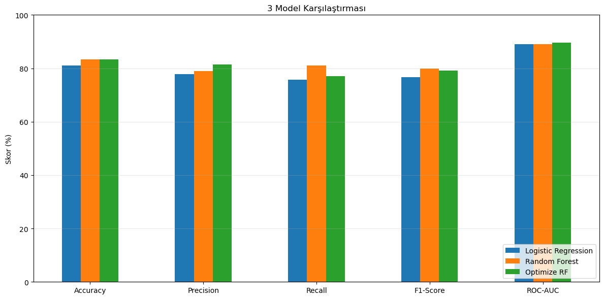

# Titanic Data Analysis

**TR**

Titanic yolcularının bilgilerinden (cinsiyet, yaş, bilet sınıfı, aile durumu vb.) hayatta kalıp kalmadıklarını tahmin eden uçtan uca bir makine öğrenmesi projesi. Keşifsel veri analizinden (EDA) model optimizasyonuna kadar tüm veri bilimi sürecini kapsar.


**EN**

An end-to-end machine learning project that predicts whether Titanic passengers survived, using their attributes (gender, age, ticket class, family status, etc.). The project walks through the full data science process — from exploratory data analysis (EDA) all the way to model optimization.


---
## Proje Akışı / Pipeline
1. Library and Dataset Import 
2. Exploratory Data Analysis (EDA)
3. Missing Value Imputation
4. Outlier Handling
5. Feature Engineering
   - Rare Category Grouping 
   - Categorical Variable Encoding (Encoding)
6. Post-Feature Engineering EDA
7. Feature Selection
8. Model Training 
   - Logistic Regression
   - Random Forest
9. Model Evaluation and Cross Validation
10. Model Comparison
11. Hyperparameter Tuning
12. Feature Importance
13. Feature Reduction and Retraining


---

## Teknolojiler / Technologies
- **Pandas**
- **NumPy**
- **Matplotlib**
- **Scikit-learn** (Logistic Regression, Random Forest, GridSearchCV, metrics)
- **Jupyter**

---

## Sonuçlar / Results

---

## Kurulum / Installation
1. Depoyu klonlayın:

   ```bash
   git clone https://github.com/your-username/titanic-data-analysis.git
   ```
2. Proje klasörüne gidin:

   ```bash
   cd titanic-data-analysis
   ```
3. Gerekli kütüphaneleri yükleyin:

   ```bash
   pip install -r requirements.txt
   ```
4. Jupyter Notebook'u başlatın :

   ```bash
   jupyter notebook titanic_survival_analysis.ipynb
   ```
---

## License
[MIT](https://choosealicense.com/licenses/mit/)